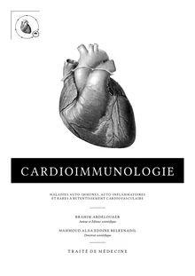
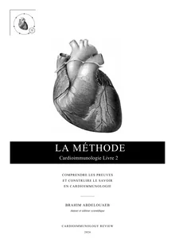
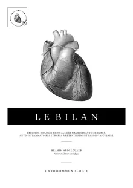
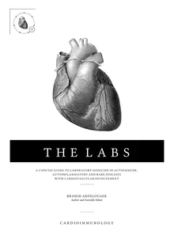
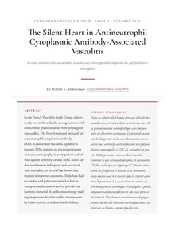
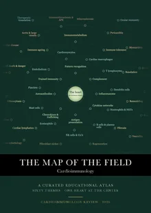

# Cardioimmunology Review

**The heart, an immune organ: open-access books, review articles and a map of the field in cardioimmunology.**

[](https://cardioimmunologyreview.org/)
[](https://orcid.org/0009-0002-7690-9993)
[](https://doi.org/10.5281/zenodo.23822648)
[](https://creativecommons.org/licenses/by-nc-nd/4.0/)

Cardioimmunology Review is an independent editorial collection by **Dr Brahim Abdelouaeb**, physician in Paris. It covers autoimmune, autoinflammatory and rare diseases with cardiovascular involvement: their mechanisms, laboratory assessment and clinical reasoning. It also covers the methods used to evaluate the evidence.

All works are free to read online and to download. Each one has a DOI on Zenodo. Titles below link to their page on the website.

**Read online:** [cardioimmunologyreview.org](https://cardioimmunologyreview.org/) (English) · [version française](https://cardioimmunologyreview.org/fr.html)

<p align="center">
  <a href="https://cardioimmunologyreview.org/traite.html"></a>
  <a href="https://cardioimmunologyreview.org/method/la-methode.html"></a>
  <a href="https://cardioimmunologyreview.org/method/the-method.html"></a>
  <a href="https://cardioimmunologyreview.org/le-bilan.html"></a>
  <a href="https://cardioimmunologyreview.org/the-labs.html"></a>
  <a href="https://cardioimmunologyreview.org/review.html"></a>
  <a href="https://cardioimmunologyreview.org/constellation-method.html"></a>
</p>

> **En français.** Cardioimmunology Review est la collection du Dr Brahim Abdelouaeb, médecin à Paris, consacrée aux maladies auto-immunes, auto-inflammatoires et rares à retentissement cardiovasculaire : le *Traité de Cardioimmunologie*, *La Méthode*, *Le Bilan*, la revue *Cardioimmunology Review* et la carte du domaine. Tous les ouvrages sont en accès libre, avec un DOI Zenodo. [Lire le site en français](https://cardioimmunologyreview.org/fr.html).

## Publications

### Books

| Work | Language | Pages | DOI |
|---|---|---|---|
| [*Cardioimmunologie : Maladies auto-immunes, auto-inflammatoires et rares à retentissement cardiovasculaire. Traité de médecine*](https://cardioimmunologyreview.org/traite.html) (2026), scientific direction by Mahmoud Alaa Eddine Belkenadil | French | 1,195 | [10.5281/zenodo.23822648](https://doi.org/10.5281/zenodo.23822648) |
| [*La Méthode : Comprendre les preuves et construire le savoir en cardioimmunologie*](https://cardioimmunologyreview.org/method/la-methode.html) (Cardioimmunologie, Livre 2, 2026) | French | 388 | [10.5281/zenodo.23822651](https://doi.org/10.5281/zenodo.23822651) |
| [*The Method: Understanding Evidence and Building Knowledge in Cardioimmunology*](https://cardioimmunologyreview.org/method/the-method.html) (Cardioimmunology, Book 2, 2026) | English | 378 | [10.5281/zenodo.23822652](https://doi.org/10.5281/zenodo.23822652) |
| [*Le Bilan : Précis de biologie médicale des maladies auto-immunes, auto-inflammatoires et rares à retentissement cardiovasculaire*](https://cardioimmunologyreview.org/le-bilan.html) (2026, corrected edition) | French | 199 | [10.5281/zenodo.23822649](https://doi.org/10.5281/zenodo.23822649) |
| [*The Labs: A Concise Guide to Laboratory Medicine in Autoimmune, Autoinflammatory and Rare Diseases with Cardiovascular Involvement*](https://cardioimmunologyreview.org/the-labs.html) (2026), translated by Ambre Marchand | English | 194 | [10.5281/zenodo.23822650](https://doi.org/10.5281/zenodo.23822650) |

### Review

| Article | Language | DOI |
|---|---|---|
| [*The Silent Heart in Antineutrophil Cytoplasmic Antibody-Associated Vasculitis*](https://cardioimmunologyreview.org/revue/n1-the-silent-heart.html). Cardioimmunology Review, Issue 1 (October 2026) | English | [10.5281/zenodo.23822653](https://doi.org/10.5281/zenodo.23822653) |
| [*Le cœur silencieux des vascularites associées aux ANCA*](https://cardioimmunologyreview.org/revue/n1-le-coeur-silencieux.html). Cardioimmunology Review, n° 1 (octobre 2026) | French | [Read online](https://cardioimmunologyreview.org/revue/n1-le-coeur-silencieux.html) |

### Companion works

| Work | Language | DOI |
|---|---|---|
| [*The Map of the Field, Cardioimmunology: A curated educational atlas and its method*](https://cardioimmunologyreview.org/constellation-method.html), version 1.0.0 (dataset, 2026) | English | [10.5281/zenodo.23468276](https://doi.org/10.5281/zenodo.23468276) |
| *Scientific and Clinical Architecture of the Treatise on Cardioimmunology* (2026) | English | [10.5281/zenodo.23248048](https://doi.org/10.5281/zenodo.23248048) |
| [*Architecture scientifique et clinique du Traité de Cardioimmunologie*](https://cardioimmunologyreview.org/architecture-traite-cardioimmunologie.html) (2026) | French | [10.5281/zenodo.23248208](https://doi.org/10.5281/zenodo.23248208) |

## How to cite

> Abdelouaeb, B. (2026). *Cardioimmunologie : Maladies auto-immunes, auto-inflammatoires et rares à retentissement cardiovasculaire. Traité de médecine*. Cardioimmunology Review. https://doi.org/10.5281/zenodo.23822648

```bibtex
@book{abdelouaeb2026cardioimmunologie,
  author    = {Abdelouaeb, Brahim},
  title     = {{Cardioimmunologie : Maladies auto-immunes, auto-inflammatoires et rares à retentissement cardiovasculaire. Traité de médecine}},
  year      = {2026},
  publisher = {Cardioimmunology Review},
  language  = {french},
  doi       = {10.5281/zenodo.23822648},
  url       = {https://doi.org/10.5281/zenodo.23822648}
}
```

BibTeX records for every work are in [`publications.bib`](publications.bib), with separate files for the [English](publications-en.bib) and [French](publications-fr.bib) works. Formatted references are on the [references page](https://cardioimmunologyreview.org/references.html). GitHub's **Cite this repository** button uses [`CITATION.cff`](CITATION.cff).

## Author

**Brahim Abdelouaeb**, MD, physician in Paris, author and editor of Cardioimmunology Review.

[ORCID](https://orcid.org/0009-0002-7690-9993) · [HAL](https://cv.hal.science/brahim-abdelouaeb) · [Google Scholar](https://scholar.google.com/citations?user=Uw_YszUAAAAJ) · [ResearchGate](https://www.researchgate.net/profile/Brahim-Abdelouaeb-2) · [Author page](https://cardioimmunologyreview.org/author.html)

Editorial principles and disclosure of interests are set out in the [editorial charter](https://cardioimmunologyreview.org/charte-editoriale.html).

## Licence

The books and articles are released under [CC BY-NC-ND 4.0](https://creativecommons.org/licenses/by-nc-nd/4.0/). The map of the field is released under [CC BY 4.0](https://creativecommons.org/licenses/by/4.0/).

These works are for education. They do not replace individual medical advice.

## About this repository

This repository contains the source of [cardioimmunologyreview.org](https://cardioimmunologyreview.org/): static, bilingual pages served by GitHub Pages. The online reader uses [PDF.js](https://mozilla.github.io/pdf.js/) (Apache 2.0, see `assets/book-pdf-LICENSE.txt`) and displays the original PDFs unchanged.
