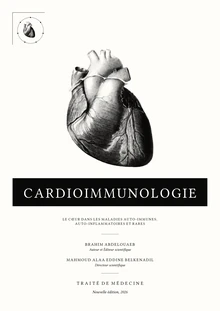
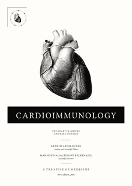
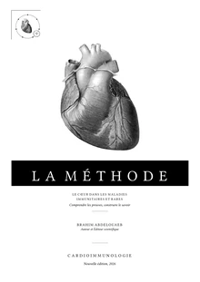
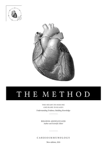
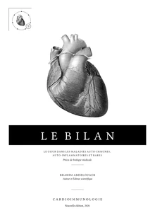
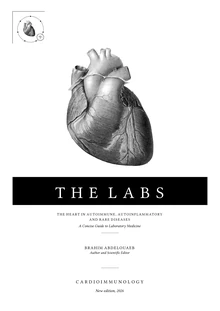
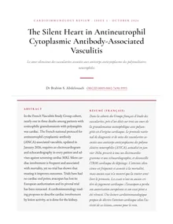
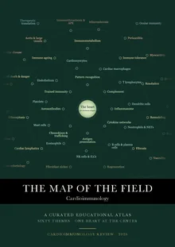

# Cardioimmunology Review

**The heart, an immune organ: open-access books, review articles and a map of the field in cardioimmunology.**

[](https://cardioimmunologyreview.org/)
[](https://orcid.org/0009-0002-7690-9993)
[](https://doi.org/10.5281/zenodo.24393384)
[](https://doi.org/10.5281/zenodo.24393475)
[](https://creativecommons.org/licenses/by-nc-nd/4.0/)

Cardioimmunology Review is an independent editorial collection by **Dr Brahim Abdelouaeb**, physician in Paris. It covers autoimmune, autoinflammatory and rare diseases with cardiovascular involvement: their mechanisms, laboratory assessment and clinical reasoning. It also covers the methods used to evaluate the evidence.

All works are free to read online and to download. Each one has a DOI on Zenodo. Titles below link to their page on the website.

**Read online:** [cardioimmunologyreview.org](https://cardioimmunologyreview.org/) (English) · [version française](https://cardioimmunologyreview.org/fr.html)

<p align="center">
  <a href="https://cardioimmunologyreview.org/traite.html"></a>
  <a href="https://cardioimmunologyreview.org/treatise/"></a>
  <a href="https://cardioimmunologyreview.org/method/la-methode.html"></a>
  <a href="https://cardioimmunologyreview.org/method/the-method.html"></a>
  <a href="https://cardioimmunologyreview.org/le-bilan.html"></a>
  <a href="https://cardioimmunologyreview.org/the-labs.html"></a>
  <a href="https://cardioimmunologyreview.org/review.html"></a>
  <a href="https://cardioimmunologyreview.org/constellation-method.html"></a>
</p>

> **En français.** Cardioimmunology Review est la collection du Dr Brahim Abdelouaeb, médecin à Paris, consacrée aux maladies auto-immunes, auto-inflammatoires et rares à retentissement cardiovasculaire : le *Traité de Cardioimmunologie* (édition anglaise : *Cardioimmunology*), *La Méthode*, *Le Bilan*, la revue *Cardioimmunology Review* et la carte du domaine. Tous les ouvrages sont en accès libre, avec un DOI Zenodo. [Lire le site en français](https://cardioimmunologyreview.org/fr.html).

## Publications

### Books

| Work | Language | Pages | DOI |
|---|---|---|---|
| [*Cardioimmunologie. Le cœur dans les maladies auto-immunes, auto-inflammatoires et rares. Traité de médecine*](https://cardioimmunologyreview.org/traite.html) (2026), scientific direction by Mahmoud Alaa Eddine Belkenadil | French | 1,522 | [10.5281/zenodo.24393384](https://doi.org/10.5281/zenodo.24393384) |
| [*Cardioimmunology. The Heart in Immune and Rare Diseases. A Treatise of Medicine*](https://cardioimmunologyreview.org/treatise/) (2026), scientific direction by Mahmoud Alaa Eddine Belkenadil | English | 1,454 | [10.5281/zenodo.24393475](https://doi.org/10.5281/zenodo.24393475) |
| [*La Méthode. Le cœur dans les maladies immunitaires et rares : comprendre les preuves, construire le savoir*](https://cardioimmunologyreview.org/method/la-methode.html) (Cardioimmunologie, Livre 2, 2026) | French | 359 | [10.5281/zenodo.24390755](https://doi.org/10.5281/zenodo.24390755) |
| [*The Method. The Heart in Immune and Rare Diseases: Understanding Evidence, Building Knowledge*](https://cardioimmunologyreview.org/method/the-method.html) (Cardioimmunology, Book 2, 2026) | English | 349 | [10.5281/zenodo.24390767](https://doi.org/10.5281/zenodo.24390767) |
| [*Le Bilan. Le cœur dans les maladies auto-immunes, auto-inflammatoires et rares. Précis de biologie médicale*](https://cardioimmunologyreview.org/le-bilan.html) (new edition, 2026) | French | 199 | [10.5281/zenodo.24393543](https://doi.org/10.5281/zenodo.24393543) |
| [*The Labs. The Heart in Autoimmune, Autoinflammatory and Rare Diseases. A Concise Guide to Laboratory Medicine*](https://cardioimmunologyreview.org/the-labs.html) (2026), translated by Ambre Marchand | English | 194 | [10.5281/zenodo.24393544](https://doi.org/10.5281/zenodo.24393544) |

### Review

| Article | Language | DOI |
|---|---|---|
| [*One Clone, Two Territories: Clonal Hematopoiesis from the Tumor to the Heart*](https://cardioimmunologyreview.org/revue/n2-one-clone-two-territories.html). Cardioimmunology Review, Issue 2 (November 2026) | English | [10.5281/zenodo.24420357](https://doi.org/10.5281/zenodo.24420357) |
| [*Un clone, deux territoires : l’hématopoïèse clonale, de la tumeur au cœur*](https://cardioimmunologyreview.org/revue/n2-un-clone-deux-territoires.html). Cardioimmunology Review, n° 2 (novembre 2026) | French | [10.5281/zenodo.24420321](https://doi.org/10.5281/zenodo.24420321) |
| [*The Silent Heart in Antineutrophil Cytoplasmic Antibody-Associated Vasculitis*](https://cardioimmunologyreview.org/revue/n1-the-silent-heart.html). Cardioimmunology Review, Issue 1 (October 2026) | English | [10.5281/zenodo.23822653](https://doi.org/10.5281/zenodo.23822653) |
| [*Le cœur silencieux des vascularites associées aux ANCA*](https://cardioimmunologyreview.org/revue/n1-le-coeur-silencieux.html). Cardioimmunology Review, n° 1 (octobre 2026) | French | [10.5281/zenodo.24209024](https://doi.org/10.5281/zenodo.24209024) |

### Companion works

| Work | Language | DOI |
|---|---|---|
| [*The Map of the Field, Cardioimmunology: A curated educational atlas and its method*](https://cardioimmunologyreview.org/constellation-method.html), version 1.1.0 (dataset, 2026) | English | [10.5281/zenodo.24420638](https://doi.org/10.5281/zenodo.24420638) |
| *Scientific and Clinical Architecture of the Treatise on Cardioimmunology* (2026) | English | [10.5281/zenodo.23248048](https://doi.org/10.5281/zenodo.23248048) |
| [*Architecture scientifique et clinique du Traité de Cardioimmunologie*](https://cardioimmunologyreview.org/architecture-traite-cardioimmunologie.html) (2026) | French | [10.5281/zenodo.23248208](https://doi.org/10.5281/zenodo.23248208) |

## How to cite

> Abdelouaeb, B. (2026). *Cardioimmunologie. Le cœur dans les maladies auto-immunes, auto-inflammatoires et rares. Traité de médecine*. Cardioimmunology Review. https://doi.org/10.5281/zenodo.24393384

> Abdelouaeb, B. (2026). *Cardioimmunology. The Heart in Immune and Rare Diseases. A Treatise of Medicine*. Cardioimmunology Review. https://doi.org/10.5281/zenodo.24393475

```bibtex
@book{abdelouaeb2026cardioimmunologie,
  author    = {Abdelouaeb, Brahim},
  title     = {{Cardioimmunologie. Le cœur dans les maladies auto-immunes, auto-inflammatoires et rares. Traité de médecine}},
  year      = {2026},
  publisher = {Cardioimmunology Review},
  language  = {french},
  doi       = {10.5281/zenodo.24393384},
  url       = {https://doi.org/10.5281/zenodo.24393384}
}
```

BibTeX records for every work are in [`publications.bib`](publications.bib), with separate files for the [English](publications-en.bib) and [French](publications-fr.bib) works. Formatted references are on the [references page](https://cardioimmunologyreview.org/references.html). GitHub's **Cite this repository** button uses [`CITATION.cff`](CITATION.cff).

## Author

**Brahim Abdelouaeb**, MD, physician in Paris, author and editor of Cardioimmunology Review.

[ORCID](https://orcid.org/0009-0002-7690-9993) · [HAL](https://cv.hal.science/brahim-abdelouaeb) · [Google Scholar](https://scholar.google.com/citations?user=Uw_YszUAAAAJ) · [ResearchGate](https://www.researchgate.net/profile/Brahim-Abdelouaeb-2) · [Author page](https://cardioimmunologyreview.org/author.html)

Editorial principles and disclosure of interests are set out in the [editorial charter](https://cardioimmunologyreview.org/charte-editoriale.html).

## Licence

The books and articles are released under [CC BY-NC-ND 4.0](https://creativecommons.org/licenses/by-nc-nd/4.0/). The map of the field is released under [CC BY 4.0](https://creativecommons.org/licenses/by/4.0/).

These works are for education. They do not replace individual medical advice.

## About this repository

This repository contains the source of [cardioimmunologyreview.org](https://cardioimmunologyreview.org/): static, bilingual pages served by GitHub Pages. The online reader uses [PDF.js](https://mozilla.github.io/pdf.js/) (Apache 2.0, see `assets/book-pdf-LICENSE.txt`) and displays the original PDFs unchanged.

## Chronicle of the Review

A website takes shape the way a heart does: in layers and in beats, before anyone can see the form it will take. These are its twenty-two beats.

**I.** The house opens in two languages, and the books can be read page after page without leaving the lamp.

**II.** It fits in a pocket: reading rests in the hand, and the paths grow simpler.

**III.** The map of the field and its sixty themes learn to shine on the screen of a phone.

**IV.** The house receives its identity: its name, its way of being cited, its author.

**V.** It gives itself a face for travelling, the image that goes before it when it is shared.

**VI.** Each page bears the name of the one who wrote it, like a seal at the foot of a letter.

**VII.** The covers line up on the threshold, as a gallery, and French finds its voice there.

**VIII.** The scientific director of the Treatise is named: a book never stands alone.

**IX.** The data that speak to machines are tuned, as an instrument is tuned before the concert.

**X.** The English Treatise receives its covers and its identifiers: the translation becomes a book.

**XI.** It finds its title, its image and its way of being cited.

**XII.** The new edition of 2026 arrives in French and in English, 1,522 and 1,454 pages, with the same heart at the center.

**XIII.** The Treatise is called by its full name, and its two languages recognize each other.

**XIV.** The Treatise presents itself in both its languages, each chapter opens at its page, and the library is set in order.

**XV.** The house begins to keep its own chronicle, beat after beat.

**XVI.** The silent heart becomes citable in its own language, French, with an identifier of its own.

**XVII.** The six books arrive in their new edition, and what changed in them remains in view.

**XVIII.** The collection enters Wikidata: the author, the Review and each book take their place in the common register.

**XIX.** The stars of the map light up, each in the colour of its family and with the brightness of its connections.

**XX.** At the centre, the heart becomes a ball of molten lava, beating slowly.

**XXI.** The second issue of the Review appears: one clone, two territories.

**XXII.** The map is cited in its new version, and its archive keeps the same light.

*A map heals no one. It only keeps one from getting lost.* (The Treatise, Credo)

### En français

Un site se forme comme un cœur : par couches et par battements, sans que l'on voie d'abord la forme qu'il prendra. Voici les vingt-deux battements de celui-ci.

**I.** La maison s'ouvre en deux langues, et les livres s'y lisent page après page, sans quitter la lampe.

**II.** On l'emporte dans la poche : la lecture tient dans la main, et les chemins se simplifient.

**III.** La carte du domaine et ses soixante thèmes apprennent à briller sur l'écran d'un téléphone.

**IV.** La maison reçoit son identité : son nom, sa manière d'être citée, son auteur.

**V.** Elle se donne un visage pour voyager, l'image qui la précède quand on la partage.

**VI.** Chaque page porte le nom de celui qui l'a écrite, comme un sceau au bas d'une lettre.

**VII.** Les couvertures s'alignent sur le seuil, en galerie, et le français y trouve sa voix.

**VIII.** Le directeur scientifique du Traité est nommé : un livre ne se tient jamais seul.

**IX.** Les données qui parlent aux machines sont accordées, comme on accorde un instrument avant le concert.

**X.** Le Traité anglais reçoit ses couvertures et ses identifiants : la traduction devient un livre.

**XI.** Il trouve son titre, son image et sa manière d'être cité.

**XII.** La nouvelle édition de 2026 arrive en français et en anglais, 1 522 et 1 454 pages, avec le même cœur au milieu.

**XIII.** Le Traité est appelé par son nom entier, et ses deux langues se reconnaissent.

**XIV.** Le Traité se présente dans ses deux langues, chaque chapitre s'ouvre à sa page, et la bibliothèque se range.

**XV.** La maison commence à tenir sa propre chronique, battement après battement.

**XVI.** Le cœur silencieux devient citable dans sa langue, le français, avec un identifiant à lui.

**XVII.** Les six livres arrivent dans leur nouvelle édition, et ce qui a changé en eux reste visible.

**XVIII.** La collection entre dans Wikidata : l'auteur, la Revue et chaque livre prennent place dans le registre commun.

**XIX.** Les étoiles de la carte s'allument, chacune dans la couleur de sa famille et avec l'éclat de ses liens.

**XX.** Au centre, le cœur devient une boule de lave en fusion qui bat lentement.

**XXI.** Le deuxième numéro de la Revue paraît : un clone, deux territoires.

**XXII.** La carte est citée dans sa nouvelle version, et son archive garde la même lumière.

*Une carte ne guérit personne. Elle empêche seulement de se perdre.* (le Traité, Credo)
